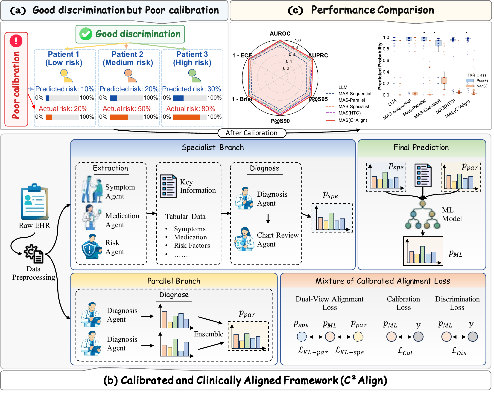

# 🩺 C²Align: Calibrating Agentic LLMs for Clinical Prediction (NeurIPS 2026)


[](https://openreview.net/forum?id=sTj2ZkCskP)
[](#)
[](https://github.com/HelloZicky/C2Align_repo)
[](LICENSE)


This is the official repository for **Calibrating Agentic LLMs for Clinical Prediction**, accepted to **NeurIPS 2026**.

**C²Align** (Calibrated and Clinically Aligned framework) improves the calibration of agentic LLMs in clinical prediction while maintaining or improving discrimination. It aligns two frozen agent branches, an ensemble of task-homogeneous parallel agents and a set of clinical task-inspired specialist agents, through a lightweight downstream model trained with a discrimination- and calibration-aware loss.

<p align="center">
  
</p>


## ✨ Highlights

- **Calibration without sacrificing discrimination**: C²Align lowers Brier score and ECE while maintaining or improving AUROC, AUPRC, and P@S95.
- **Dual-branch agents**: homogeneous parallel agents reduce generative variance; clinical specialist agents inject task knowledge as fixed JSON indicators.
- **Mixture of Calibrated Alignment (MoCAL) loss**: cross-entropy + Brier score + dual KL alignment to both agent branches, implemented as a custom XGBoost objective.
- **Frozen LLMs, lightweight training**: only the downstream XGBoost model is trained; any LLM can be plugged in through an inference callback.
- **Fail-closed feature policy**: a task-level allowlist builds the model matrix and rejects labels, annotations, outcomes, post-index fields, and identifiers.
- **Theory-motivated design**: conditional analyses of how agent architecture, task knowledge, and tool use affect calibration.

## 🔔 News

- **[Sept 2026]** C²Align was accepted to [NeurIPS 2026](https://openreview.net/forum?id=sTj2ZkCskP) (poster).
- **[Coming Soon]** arXiv preprint.

## 📖 Citation

If you find C²Align useful, please consider citing:

```bibtex
@inproceedings{lv2026calibrating,
  author    = {Zheqi Lv and Fuying Ding and Meihan Wei and Haoyang Li and Christos Faloutsos and Fei Wang and Chengxi Zang},
  title     = {Calibrating Agentic {LLMs} for Clinical Prediction},
  booktitle = {Advances in Neural Information Processing Systems},
  year      = {2026}
}
```

## 🖼️ Figures

The following paper figures are included as PDF files under [`assets/`](assets/).

| Figure | Description | Link |
|---|---|---|
| Figure 1 | The clinical calibration gap, the C²Align framework, and the performance comparison | [PDF](assets/introduction.pdf) |
| Figure 2 | ROC curve, precision-recall curve, and reliability diagram on the HF benchmark (Qwen3-Max) | [PDF](assets/exp_fig1.pdf) |

## 🧩 Supported Tasks

| Task | Dataset | C²Align entry point | Cohort construction |
|---|---|---|---|
| Heart failure (HF) diagnosis and phenotyping | MIMIC-IV | `C2Align/HF/c2align_hf.ipynb` | `Cohort_construction/build_hf_cohort.ipynb` |
| Alzheimer's disease and related dementias (ADRD) diagnosis and phenotyping | MIMIC-IV | `C2Align/ADRD/c2align_adrd.ipynb` | `Cohort_construction/build_adrd_cohort.ipynb` |
| 30-day unplanned readmission, Readmission (IV) | MIMIC-IV | `C2Align/Readmission/c2align_readmission_mimic4.ipynb` | Prepared from MIMIC-IV (see Quick Start) |
| 30-day unplanned readmission, Readmission (III) | MIMIC-III | `C2Align/Readmission/c2align_readmission_mimic3.ipynb` | Prepared from MIMIC-III (see Quick Start) |

The notebooks are LLM-agnostic. The paper reports results with Qwen3-Max, ChatGPT-4o, Gemini-2.5, DeepSeek-V4, and LLaMA-3.1-8B.

## ⚙️ Installation

```bash
git clone https://github.com/HelloZicky/C2Align_repo.git
cd C2Align_repo
python -m venv .venv
source .venv/bin/activate
pip install -r requirements.txt
```

Python 3.10 or later is recommended.

## 🔐 Data Access

This repository does not contain patient records, identifiers, clinical notes, credentials, completed physician annotation forms, or generated branch outputs.

- MIMIC-III and MIMIC-IV are available through [PhysioNet](https://physionet.org/) to credentialed researchers under the PhysioNet Credentialed Health Data Use Agreement.
- Send clinical text only to LLM endpoints that are permitted under that agreement; see PhysioNet's guidance on the responsible use of credentialed data with online services.
- Keep all protected data and every generated table outside the repository.

## 🚀 Quick Start

Each task notebook defines its prompts, branch workflow, feature allowlist, and training code. Run the definition cells from top to bottom, then follow the steps below.

```text
C2Align_repo/
├── Cohort_construction/
│   ├── build_hf_cohort.ipynb       # Step 1 for HF
│   └── build_adrd_cohort.ipynb     # Step 1 for ADRD
└── C2Align/
    ├── HF/c2align_hf.ipynb                                # Steps 2-3 for HF
    ├── ADRD/c2align_adrd.ipynb                            # Steps 2-3 for ADRD
    └── Readmission/
        ├── c2align_readmission_mimic4.ipynb               # Steps 2-3 for Readmission (IV)
        └── c2align_readmission_mimic3.ipynb               # Steps 2-3 for Readmission (III)
```

### Step 1: Build the cohort

For HF and ADRD, open the cohort-construction notebook and set:

| Variable | Meaning |
|---|---|
| `DATA_ROOT` | Local MIMIC-IV directory (reads `hosp/diagnoses_icd.csv`, `hosp/admissions.csv`, `hosp/patients.csv`) |
| `CODE_DICTIONARY` | Excel file whose `dx code` column lists the target ICD codes |
| `ANNOTATION_INPUT` | Completed physician annotation sheet |
| `OUTPUT_DIR` | Output directory outside the repository |

Then run:

1. `prepare_annotation_sheet()` selects 500 code-positive and 500 matched code-negative patients and writes an annotation template.
2. Two physicians label each patient independently, and a senior expert adjudicates disagreements.
3. `finalize_patient_level_cohort()` applies the adjudication rules and writes the patient-level train/test split (HF: 730/243; ADRD: 712/238).

The branch notebooks read each patient's clinical note from a `text` column. Add it to both tables from your authorized MIMIC note data before Step 2.

For Readmission (III) and (IV), prepare one row per patient (800 train / 200 test) with `subject_id`, `label_numerical`, `admit_age`, `los_days`, `gender`, `race`, `admission_type`, `discharge_location`, `all_icd_codes`, and `text`. All inputs must end at discharge from the index hospitalization.

### Step 2: Run the two agent branches

Connect an LLM through `configure_inference_callback`. The callback receives the system prompt and the user prompt and returns a JSON object (or a string containing one) that follows the schema in the prompt.

```python
import pandas as pd

def my_llm(system_prompt, prompt, seed, temperature):
    # Call an LLM endpoint that is approved for your data and return its JSON answer.
    ...

configure_inference_callback(my_llm)

train = pd.read_csv("path/to/hf_train_patient_level.csv")
test = pd.read_csv("path/to/hf_test_patient_level.csv")
for split, rows in (("train", train), ("test", test)):
    generate_branch_outputs(rows, "specialist", f"path/to/outputs/specialist_{split}.csv")
    generate_branch_outputs(rows, "parallel", f"path/to/outputs/parallel_{split}.csv")
```

In the readmission notebooks the call is `generate_branch_outputs(rows, TARGET_TASK, branch, output_path, USE_CHART_REVIEW, NUM_PARALLEL_AGENTS)`.

### Step 3: Train and evaluate C²Align

```python
model, cv_metrics, test_metrics, predictions = run_method5_from_csv(
    "path/to/outputs/specialist_train.csv",
    "path/to/outputs/specialist_test.csv",
    "path/to/outputs/parallel_train.csv",
    "path/to/outputs/parallel_test.csv",
)
print(test_metrics["auc"], test_metrics["brier"])
```

`run_method5_from_csv` aligns the two branches by patient, checks that the train and test patients are disjoint, builds the allowlisted model matrix, runs patient-level five-fold cross-validation on the training set, and evaluates on the test set. In the notebooks, "Method 5 MoE_b (Dual KL Calib)" is C²Align.

### Verification

```bash
python -m unittest discover -s tests -v
```

The tests check the feature allowlist, the notebook integration, clean notebook state, and that no data files or machine-specific paths are committed.

## 🔧 Recommended Hyperparameters

Defaults in the released notebooks:

| Parameter | HF | ADRD | Readmission (IV) | Readmission (III) |
|---|---:|---:|---:|---:|
| Parallel agents (`num_agents` / `NUM_PARALLEL_AGENTS`) | `2` | `2` | `3` | `3` |
| Specialist chart review (`use_chart_review` / `USE_CHART_REVIEW`) | `True` | `True` | `True` | `False` |
| LLM temperature | `0.0` | `0.0` | `0.0` | `0.0` |
| $\alpha$ (Brier weight) | `0.05` | `0.05` | `0.05` | `0.05` |
| $\beta_{\text{spe}}$, $\beta_{\text{par}}$ (KL weights) | `0.05` | `0.05` | `0.05` | `0.05` |
| XGBoost `n_estimators` / `max_depth` / `learning_rate` | `300` / `4` / `0.03` | `300` / `4` / `0.03` | `300` / `4` / `0.03` | `300` / `4` / `0.03` |
| XGBoost `subsample` / `colsample_bytree` | `0.8` / `0.8` | `0.8` / `0.8` | `0.8` / `0.8` | `0.8` / `0.8` |
| Random seed | `1` | `1` | `1` | `1` |

The search spaces are listed in the appendix of the paper (Table "Experimental settings and hyperparameters").

## 📊 Results

C²Align with the Qwen3-Max backbone (Table 1 of the paper):

| Task | AUROC ↑ | AUPRC ↑ | P@S95 ↑ | BS ↓ | ECE ↓ | Notes |
|---|---:|---:|---:|---:|---:|---|
| HF | 0.9927 | 0.9940 | 0.9530 | 0.0336 | 0.0294 | BS 26.80% and ECE 31.31% lower than the strongest baseline |
| ADRD | 0.9962 | 0.9971 | 1.0000 | 0.0210 | 0.0273 | BS 49.03% lower than the strongest baseline |
| Readmission (IV) | 0.7128 | 0.7098 | 0.6076 | 0.2210 | 0.1214 | AUROC +0.0734 over the strongest baseline |
| Readmission (III) | 0.6674 | 0.4068 | 0.3598 | 0.1851 | 0.0702 | ECE 15.42% lower than the strongest baseline |

Please refer to the paper for the full comparison with LR, XGBoost, single LLMs, sequential and parallel multi-agent systems, post-hoc calibration, and trajectory calibration, as well as other LLM backbones and the external TJH cohort.

## 🧠 Method Overview

C²Align runs in six steps:

1. **Parallel branch** (frozen): $M$ independent, homogeneous agents each return a probability, and their average gives $p_{\text{par}}$ (`run_parallel_branch`).
2. **Specialist branch** (frozen): symptom, medication/intervention, and risk agents extract fixed task indicators $x_{\text{spe}}$; a diagnosis agent, optionally followed by a chart-review agent, returns $p_{\text{spe}}$ (`run_specialist_branch`).
3. **Join**: both outputs are joined with structured covariates by patient ID and schema-validated (`align_branch_outputs`).
4. **Allowlist**: a task-level allowlist builds the feature vector $x_{\text{struct}} \oplus x_{\text{spe}} \oplus p_{\text{par}} \oplus p_{\text{spe}}$ (`MODEL_FEATURE_COLUMNS`, `c2align_feature_policy.py`).
5. **Train**: only the downstream XGBoost model is trained, with the MoCAL loss as a custom objective (`get_custom_xgb_obj_bin_dual_kl`):

   $$\mathcal{L}_{\text{total}} = \mathcal{L}_{\text{Dis}} + \alpha\,\mathcal{L}_{\text{Cal}} + \beta_{\text{par}}\,D_{\mathrm{KL}}(p_{\text{par}} \,\|\, p_{\text{ML}}) + \beta_{\text{spe}}\,D_{\mathrm{KL}}(p_{\text{spe}} \,\|\, p_{\text{ML}})$$

   where $\mathcal{L}_{\text{Dis}}$ is cross-entropy and $\mathcal{L}_{\text{Cal}}$ is the Brier score.
6. **Evaluate**: the model's probability $p_{\text{ML}}$ is evaluated on the held-out test patients.

## 📁 Repository Structure

```text
C2Align_repo/
├── C2Align/
│   ├── ADRD/                       # ADRD prompts, branches, and C²Align training
│   ├── HF/                         # HF prompts, branches, and C²Align training
│   └── Readmission/                # Readmission (III) and (IV) notebooks
├── Cohort_construction/            # HF and ADRD cohort construction and annotation workflow
├── assets/                         # Paper figure PDFs and the README overview image
├── tests/                          # Feature-policy, notebook-integration, and hygiene tests
├── c2align_feature_policy.py       # Fail-closed feature allowlist
├── requirements.txt
├── LICENSE
└── README.md
```

## 📖 Citation

If you find C²Align useful, please consider citing:

```bibtex
@inproceedings{lv2026calibrating,
  author    = {Zheqi Lv and Fuying Ding and Meihan Wei and Haoyang Li and Christos Faloutsos and Fei Wang and Chengxi Zang},
  title     = {Calibrating Agentic {LLMs} for Clinical Prediction},
  booktitle = {Advances in Neural Information Processing Systems},
  year      = {2026}
}
```

## 🙏 Acknowledgements

We thank the MIT Laboratory for Computational Physiology and PhysioNet for MIMIC-III and MIMIC-IV, the providers of the TJH dataset, and the developers of XGBoost, scikit-learn, and pandas.

## 📄 License

This project is released under the MIT License.

## ⚠️ Responsible Use

C²Align is research code for clinical prediction, not a medical device, and it has not been validated for clinical deployment. Its outputs are meant to support, not replace, clinician judgment. Calibration can shift across hospitals and populations, so re-evaluate calibration on local data before any use. Use protected health data only under the applicable data-use agreements and only with LLM services that those agreements permit.
